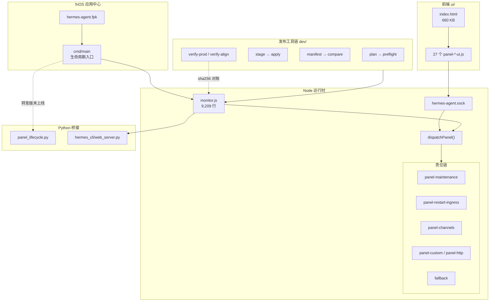

<div align="center">

# fnos-hermes-panel

**把 12,325 行的单体面板，拆成 53 个各管一段的模块**

[](LICENSE)
[]()

GPL-3.0 衍生 · 基线来自 [iranee](https://github.com/iranee/fnos-hermes-agent) 原创与 [veenyi](https://github.com/veenyi/fnos-hermes-agent) 的 fnOS 适配 · 六天 774 提交 · 198 文件逐字节对账

[这是什么](#这是什么) · [改了什么](#改了什么) · [架构](#架构) · [三个结论](#三个结论) · [工具清单](#工具清单) · [安装](#安装) · [致谢与许可](#致谢与许可)

</div>

---

## 这是什么

**fnOS（飞牛 NAS）上 Hermes Agent 控制面板的重构分支。**

上游是一个单体：`server/monitor.js` 12,325 行。HTTP 路由、进程生命周期、渠道接入、配置事务、任务队列、语音合成，全在一个文件里。改一处路由要先读掉三千行上下文，测一个接口要把整个进程拉起来。

这个分支用六天把它拆开：

- 路由分发改成**责任链**，53 个 `panel-*.js` 各认领一段
- 前端同步拆分，27 个 `ui/js/panel-*.js`
- 补一套**发布工具链**，把「部署」变成可计划、可回滚、可演练的动作
- 建立**逐字节对账**，让 `git checkout` 真的能重建生产

**先说清楚这不是从零写的项目。** 基线是 iranee 的原创实现，经 veenyi 做了 fnOS 基座适配。这个仓库是面板层的工程化重构，不是替代品。改造边界写在[致谢与许可](#致谢与许可)。

---

## 改了什么

### 一、把巨型分发改成责任链

改造前，所有 `/api/*` 落进一个巨型分支判断。改造后，`dispatchPanel()` 依次询问各模块，谁认领谁处理，全都不认才落到兜底：

```
maintenance → restart → channels → custom → main
```

每环只管自己那段，返回 `null` 就下传。加功能不用改老代码，测一环不用拉起全进程。

| | 改造前 | 改造后 |
|---|---|---|
| `server/monitor.js` | 12,325 行 | 9,209 行 |
| `server/panel-*.js` | 0 | **53 个 / 2,973 行** |
| `ui/js/panel-*.js` | 0 | **27 个 / 2,255 行** |

留下的 9,209 行是进程生命周期、socket 服务、dispatch 骨架——这些不该拆，拆了反而多一层跳转。

### 二、部署从 `cp` 变成有账本的动作

手工覆盖上百个文件，靠事后 `md5` 核对，出错时说不清错在哪一步。改成流水线：

```
release-plan.py        算出这次动哪些文件
release-preflight.sh   闸门：清单校验、哈希校验、事务预演
release-stage.py       落到隔离暂存区
release-apply.py       原子替换，失败回滚
release-manifest.py    生成发布清单（每文件 sha256）
release-compare.py     比对候选与生产
release-rehearsal.py   回滚演练
release-runtime-rehearsal.py  运行层演练
```

8 个脚本、1,032 行。每次部署留一份冻结包与逐文件哈希，出问题能精确回到上一个已知好状态——不是「大概回滚一下」。

### 三、对账对到字节

`dev/verify-prod.sh`（150 行）和 `dev/verify-align.sh`（66 行）做同一件事：把 git 快照与运行目录逐文件 sha256 比对。

```
app/*  →  /vol1/@appcenter/hermes-agent/*
cmd/*  →  /var/apps/hermes-agent/cmd/*
```

当前结果：

```
一致     : 198
不同     : 0
生产缺失  : 0
已知漂移  : 1
VERDICT: PASS
```

那 1 个漂移是 `cmd/main`：git 里是 890 字节的转发版（`exec panel_lifecycle.py`），生产仍在跑 2026-08-24 安装时的 4,365 字节 bash PID 管理版。新实现写好了但没上线——这是真实状态，不粉饰。

---

## 架构



**要点一：responsibility chain 的边界，就是模块的边界。** 每环只处理自己前缀的路由，返回 `null` 表示「不归我管」。这让「新增一个功能」和「修一个老功能」不再争同一段代码。

**要点二：前端是独立的第二套拆分。** `index.html` 仍是单文件（660 KB，含内联样式与骨架），但交互逻辑抽到 27 个 `panel-*-ui.js`，各自绑定自己的 DOM 段。

**要点三：Python 层不重写，只桥接。** `hermes-src` 是上游内核，通过 `importlib.spec_from_file_location` 装进 `sys.modules` 假名，`server/` 下只做薄封装。内核升级不冲突。

---

## 三个结论

这三条不是设计出来的，是撞出来的。

### 一、两条历史并行，等于没有历史

改造期间，NAS 上的 `main` 和 Mac 上的工作分支各自往前走。NAS 那份停在旧版，Mac 那份累积了 774 个提交——包括最后四批已部署到生产的改动。

结果：**生产在跑的内容，`git checkout` 重建不出来。** 想复现线上状态得先把 Mac 的分支捞回来，再手工补齐 NAS 侧的工具文件。

修复方式不是 merge，是认一条主线。以 Mac 分支（含完整演化史）为新基线，把 NAS 独有内容补上去，旧线存成 `archive/`。修复后 198 文件零差异，`cmd/main` 单独标注。

**教训：并行分支要尽早合并，或者一开始就别并行。**

### 二、部署不是 `cp`，是带账本的原子动作

早期部署是「复制 133 个文件过去，然后 md5 核对」。看似可靠，实际上：中途失败不知道停在哪、回滚靠记忆、冻结包和实际部署的文件对不上号。

改成 plan → preflight → stage → apply → manifest 之后，每一步都有落盘的中间产物。**能演练的回滚才叫回滚**，不能演练的只是祈祷。

### 三、行数相同不代表内容相同

`monitor.js` 的 9,198 行版本和 9,209 行版本，乍看只差 11 行注释。实际是两个不同来源的文件——一个是 Mac 分支末端，一个是 NAS 上手工打的补丁，注释位置和内容都不同。

当时差点按「行数差不多」判定为同一个。

**对账必须逐字节 sha256，行数只能当提示。**

---

## 工具清单

### 发布与验证

| 脚本 | 行数 | 作用 |
|---|---|---|
| `dev/release-plan.py` | 133 | 生成部署计划 |
| `dev/release-preflight.sh` | 183 | 上线前闸门 |
| `dev/release-stage.py` | 94 | 隔离暂存 |
| `dev/release-apply.py` | 322 | 原子替换与回滚 |
| `dev/release-manifest.py` | 56 | 发布清单 |
| `dev/release-compare.py` | 37 | 候选 vs 生产比对 |
| `dev/release-rehearsal.py` | 70 | 回滚演练 |
| `dev/release-runtime-rehearsal.py` | 137 | 运行层演练 |
| `dev/verify-prod.sh` | 150 | 生产 vs git 对账 |
| `dev/verify-align.sh` | 66 | 对齐后逐字节校验 |
| `dev/hermes-dev.sh` | 231 | 开发入口：restart / probe / preview |

### 模块规模

| 目录 | 文件数 | 说明 |
|---|---|---|
| `app/server/panel-*.js` | 53 | 服务端责任链模块，2,973 行 |
| `app/ui/js/panel-*.js` | 27 | 前端交互模块，2,255 行 |
| `app/python/` | — | Python 桥接层，薄封装 |
| `app/server/monitor.js` | 1 | 骨架：生命周期、socket、dispatch |

---

## 安装

这是 fnOS 的 `.fpk` 应用，通过应用中心安装。

**依赖**：`nodejs_v24`（`manifest` 里声明的 `install_dep_apps`）

**安装步骤**：

1. 从 [Releases](../../releases) 下载 `.fpk`（或从本仓 `manifest` 构建）
2. fnOS 应用中心 → 手动安装 → 选择 `.fpk`
3. 首次启动后访问 `https://<NAS>:5667/app/hermes-agent/`

**开发调试**：

```bash
# 重启应用（唯一合法路径，勿用 pkill）
fnos-cli --profile nas app restart hermes-agent --yes

# 生产对账
bash dev/verify-prod.sh

# 隔离静态预览（只读 app/ui，不碰生产）
bash dev/hermes-dev.sh preview 8917
```

**目录约定**（fnOS fpk 布局）：

```
/vol1/@appcenter/hermes-agent/     应用运行目录（app/* 对应这里）
/vol1/@apphome/hermes-agent/       持久数据（data/、venv/、sessions/）
/var/apps/hermes-agent/cmd/        生命周期脚本（cmd/* 对应这里）
/var/apps/hermes-agent/var/        运行时（日志、pid）
```

---

## 文档

| 文件 | 内容 |
|---|---|
| [`docs/UPSTREAM-README.md`](docs/UPSTREAM-README.md) | 上游原版说明（安装、渠道配置、功能清单） |
| [`dev/外部改造手册.md`](dev/外部改造手册.md) | 外部工具接入的约束与流程 |
| [`CLAUDE.md`](CLAUDE.md) | 给 AI 编程助手的项目约定 |

---

## 致谢与许可

**这不是原创项目。**

```
iranee/fnos-hermes-agent    (114★)  原始实现
  └ veenyi/fnos-hermes-agent (132★)  fnOS 基座适配、Dashboard 汉化、渠道集成
      └ 本仓库                       面板层工程化重构（六天 774 提交）
```

- 原始版权归 [iranee](https://github.com/iranee/fnos-hermes-agent) 与 [veenyi](https://github.com/veenyi/fnos-hermes-agent)
- 上游内核 Hermes Agent 由 [Nous Research](https://github.com/NousResearch/hermes-agent) 开发
- 本仓库的改动同样以 **GPL-3.0** 发布，见 [`LICENSE`](LICENSE)

> **许可说明**：上游 `docs/UPSTREAM-README.md` 的徽章标注 MIT，但仓库内 `LICENSE` 文件是 GNU GPL v3 全文（35,149 字符）。本仓库以 **LICENSE 文件为准**，按 GPL-3.0 分发。

**我做的是**：把单体面板拆成责任链、补发布工具链、建立逐字节对账、清理 774 个提交里的技术债。

**我没做**：原始实现、fnOS 基座适配、Python 内核、任何上游功能。

配套阅读：[`agent-field-notes`](https://github.com/vector9584/agent-field-notes) —— 给 AI agent 定规则时撞出来的边界条件，其中 `07-hermes-patches.md` 记录了这个项目里三个失败的补丁。
