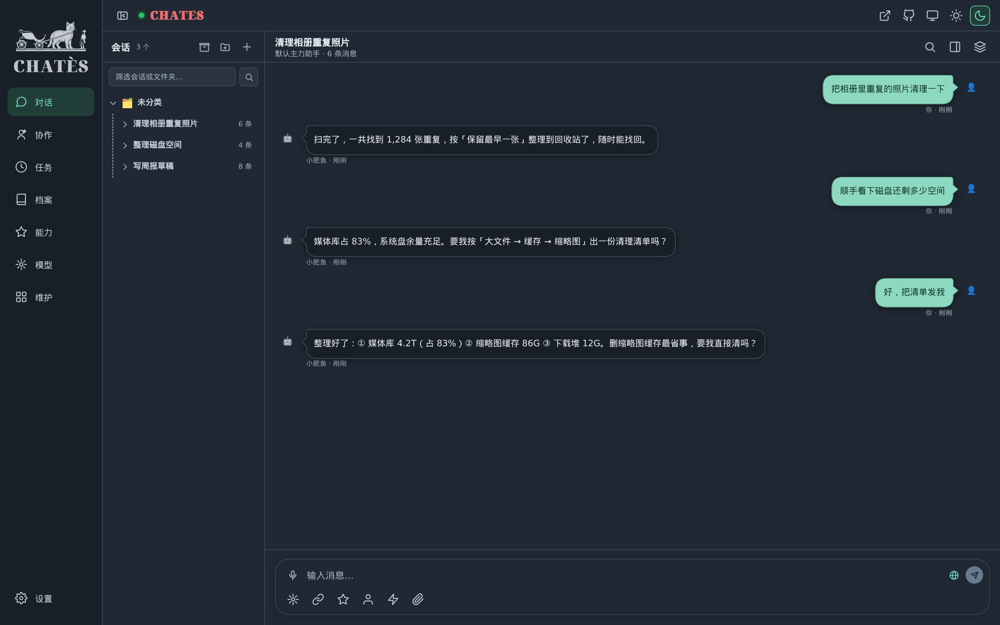
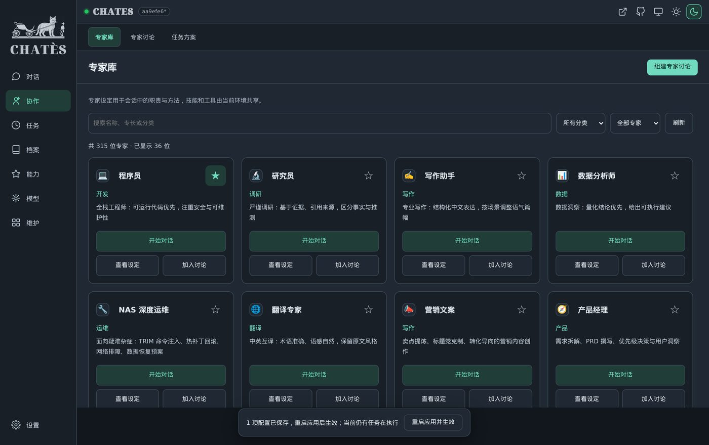
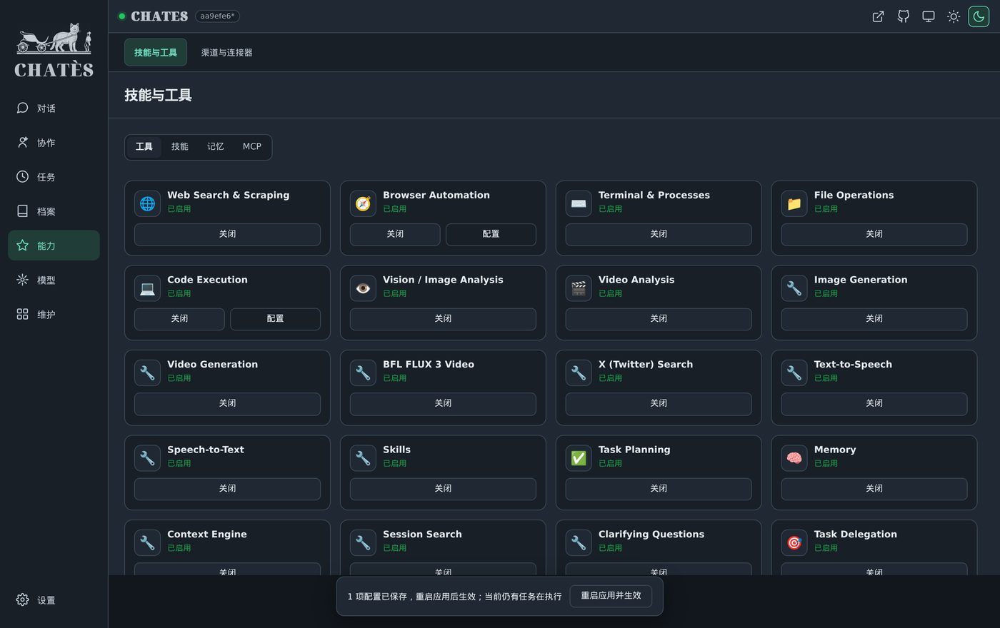

<p align="center">
  <picture>
    <source media="(prefers-color-scheme: dark)" srcset="app/ui/images/logo-cat-full-light.png">
    
  </picture>
</p>

<p align="center">
  <b>把一台 NAS 变成你自己能拆能改的 AI 工作台</b><br/>
  <sub>fnOS 上 Hermes Agent 的控制面板 · 静态 HTML + 原生 JS · 无打包器 · 无 CDN</sub>
</p>

<p align="center">
  
  
  
  
</p>

<p align="center">
  <a href="https://vector9584.github.io/fnos-hermes-panel/">项目主页</a> ·
  <a href="https://github.com/vector9584/fnos-hermes-panel/releases/latest">下载 .fpk</a> ·
  <a href="app/ui/ARCHITECTURE.md">前端架构</a> ·
  <a href="JOURNEY.md">改造历程</a>
</p>



---

## 这是什么东西

装在自己机器上的 AI 助手，大部分时间你只能隔着命令行跟它说话。这个仓库给它配了一个真正的控制台：八个板块、二十一个页面，对话、定时任务、专家讨论、技能开关、模型凭据全在里面点。

面板不替换 Hermes 内核。推理和消息网关仍由上游提供，面板通过 Unix socket 和 HTTP 代理它们。仓库里的 `app/python/` 是对上游 Python 层的补丁，不是另写一套。

前端是静态 HTML + CSS + 原生 JS，**没有打包器**。`index.html` 里 `<script>` 的顺序就是依赖顺序。这样做的好处是改一行刷新就能看见，坏处是顺序不能乱挪——`app/ui/ARCHITECTURE.md` 把这条写成了规矩。

## 现在能做什么

导航以 `app/ui/js/panel-navigation.js` 顶部的 `groups` 数组为唯一真源，当前 **8 个板块、21 个页面**。

| 板块 | 页面 | 干什么 |
|---|---|---|
| 对话 | 会话 | 流式输出、工具卡、气泡状态、发送队列与断线续发、斜杠命令、选项卡片 |
| 协作 | 专家库 · 专家讨论 · 任务方案 | 角色库、圆桌多 Agent 讨论、把讨论结论落成任务方案 |
| 任务 | 定时任务 | cron 与自然语言建任务、执行历史、前后置钩子、结果投递 |
| 档案 | 提示词 · 知识库 · 留痕录 | `SOUL.md`、`MEMORY.md`、`AGENTS.md` 都是纯文本，技能与记忆直接改 |
| 能力 | 消息渠道 · 外接工具 · 工具集 · 技能 | 逐项启用、关闭、配置，对应上游 toolsets 与通道接口 |
| 模型 | 概览 · 模型选择 · 服务商 · 能力后端 · 配置 | 供应商凭据、模型池、按域绑定生图与语音等能力后端 |
| 维护 | 运行状态 · 用量统计 · 本地版本 | 进程状态、日志按级别与组件筛、每次会话 token 用量 |
| 设置 | 偏好设置 | 主题与界面偏好 |

<table>
<tr>
<td width="50%"></td>
<td width="50%"></td>
</tr>
<tr>
<td align="center"><sub>协作 · 315 位专家，按分类筛，一键加入讨论</sub></td>
<td align="center"><sub>能力 · 二十多个工具集逐个开关，状态写在卡上</sub></td>
</tr>
</table>

### 几个重做过的机制

**加载与缓存。** 没有模块系统，改任何 JS/CSS 都要同步改引用上的 `?v=`（文件 md5 前 8 位），否则浏览器继续用旧文件。`dev/hermes-dev.sh deploy ui` 会比对并部署整组文件。

**移动端。** 导航两级折叠、胶囊栏横滑、`100dvh` 动态视口、弹窗独立滚动与底部安全区。这块主要在 `panel-navigation.js` 与 `css/base.css`。

**语音。** 录音、朗读、开口打断在 `js/chat/message-ops.js`，后端是 `app/server/panel-speech*.js`、`panel-voice-settings.js`，配置走 `/api/voice/config`，识别链路有兜底和回归测试。

**画布。** `js/chat/canvas.js` + `css/canvas.css`。它是**会话的一种呈现方式**，不是新页面也不是新会话体系：左侧会话树、顶部 header、发送链路全部沿用原实现，`#chatBody` 保留在 DOM 里只是隐藏。一轮对话画成一个节点加一条连线；点一张图即引用它，换生图模型后基于它生成下一张；同一节点能分出多条枝；支持拖拽、缩放 0.25–2.5、上→下 / 左→右两种布局。生图模型来自 `/api/workspace-ui/image-targets`，唯一真源是 `config.yaml` 的 `image_gen` 段。

**配置事务。** 写配置不是直接覆盖文件。`panel-config-txn.js` / `panel_config_txn.py` 带 `raw_hash` 冲突检测，`panel-config-recovery.*` 负责崩溃后恢复。

## 2026 年 11 月在做什么

**画布从零跑通。** 十一月中旬一连串提交把它从"能画出节点"推到"能用"：新建会话记类型、移动端双指缩放、玻璃浮层、点图即引用、拖动不丢引用、连线只做来源指引、悬停看提示词。最要紧的一步是给引用加 `refId` 凭据——**没有引用凭据就不许有线**，老存档 `version 1→2` 迁移九条全过。还修了 `.quote-block` 拼回上下文、`refFromCtx` 认两种格式这类只在真机上才暴露的问题。

**模型板块从页内页签改成真页面。** 原来是单页加页内八分区，跟协作页的导航语言对不上。现在六个域各自是 `#page-models-*`，顶部页签直接列六项，页内底槽撤掉。旧书签做了别名兜底（`models-api`、`models-moa` 这些老 id 统一落到概览，不至于 404）。

**能力面板开始区分"配了"和"真能用"。** 八个能力域各一个入口，卡片上直接写清是配好了还是能跑通。工具集枚举加了本地探测过滤，远端网关不再被当成本地模型服务去连，每次枚举省下约五秒。

**官网单页三改。** 加了「02 画布」章节（九块面板）、工具列表手机上默认折叠成八个、四件小事按痛点重写成四条。单文件自包含，图片文字全部内联，1.65 MB 一个文件拖走就能看。

## 怎么证明没改坏

拆单文件这种事最怕"看起来一样、其实少了半条逻辑"。所以每次改动都过三层：

| 层 | 手段 | 判据 |
|---|---|---|
| 静态 | `dev/arch_lint.py` | 命名与组件契约门禁；存量债登记在 `arch_lint_baseline.json`，新增违规必须处理 |
| 结构 | `dev/arch_symbols.py` | 全局符号集合与死代码体检；拆完符号数不能少 |
| 运行时 | `dev/ui_probe.py` | 计算样式与截图对比；先验资源加载、符号数、禁动画，防"两个空壳也全绿" |
| 生产 | `dev/verify-prod.sh` | 生产目录 vs git 快照逐文件比对（UI/server/bin + Python 层） |

`dev/tests/` 下 **185 个测试**（112 个 `.py`、71 个 `.mjs`、1 个 `.cjs`）以 `rebuild/` 回归为主。动过会话落盘或中断逻辑就顺手跑：

```bash
node dev/tests/interrupted-tools.cjs app/server/monitor.js
```

## 跑起来

### 一、fnOS 上装 `.fpk`（常规用法）

前提：fnOS、约 1 GB 空间、`nodejs_v24`（安装时自动处理）、Python 虚拟环境（`uv` 安装）。

1. 从 [Releases](https://github.com/vector9584/fnos-hermes-panel/releases/latest) 下载 `hermes-agent_0.21.149.fpk`（66 MB）
2. 自检：`sha256sum hermes-agent_0.21.149.fpk` 应为 `049bcd861d776a5ed4f8f49b9dcbbec7a896643133d422e285da79fc3811853c`
3. 应用中心 → 右上角「手动安装」→ 选文件 → 下一步到底；装完应用名是 `hermes-agent-clean`，与原实例并存不冲突
4. 桌面图标打开面板，「模型」页填供应商 API Key，启动服务

包内不带任何密钥，装完必须自己配；不配模型时网关不起、`18742` 空闲属正常。

运行时：面板走应用运行目录下的 `hermes-agent.sock`；`monitor.js` 把请求代理到 Gateway。发布包内面板 `18650`、Gateway `18742`、Dashboard `19219`，与原实例（`8650` / `8742` / `9219`）错开，都可用环境变量覆盖。写操作（改配置、重启进程）必须带 `monitor.token`，只读查询免鉴权，token 每次启动重新生成。

### 二、本地起面板（不依赖 fnOS）

```bash
node bin/hermes-panel.mjs --port 9000 --no-open
```

纯 TCP 模式拉起 `app/server/monitor.js`，默认端口 8650、自动找空闲端口；数据目录默认 `~/.hermes-panel/data`，与代码分开，升级不丢配置。`--data`、`--var` 可覆盖。完整对话能力仍需要本机有 Hermes 运行时与 Python venv。

### 三、只调前端样式

```bash
dev/hermes-dev.sh preview 8917
```

只读 `app/ui` 起静态服务，不碰后端与生产数据。能看到配色、间距、侧栏、按钮、空状态；看不到需要真实数据才渲染的气泡和工具卡。带数据验收用 `dev/hermes-dev.sh probe`。

页面里有 `<base href="/app/hermes-agent/">`，用 `file://` 直接打开会把相对路径解析错、资源全 404。验证必须走 HTTP。

## 想一起改？

先说清楚要什么、不要什么，省得你写完才被打回。

**受欢迎的**：能用一句话说清症状的 bug 修复、面板本身的交互/排版/性能改进、文档订正。

**直接拒的**：纯格式化 PR（只改空格引号，会把 `git blame` 冲烂）、引入外部 CDN 或在线字体（自托管要断网可用）、一个 PR 混三件事、把密钥或内网地址带进来。

**先开 issue 商量**：跨文件重构、改公开接口、新增依赖、超过 300 行的改动。

规矩全文在 [CONTRIBUTING.md](CONTRIBUTING.md)，最该看的三节：

- [Commit 怎么写](CONTRIBUTING.md#二commit-怎么写) —— 标题 72 字以内，大改动必须写清「为什么改 / 改成什么 / 怎么验证」
- [PR 怎么提](CONTRIBUTING.md#三pr-怎么提) —— 一个 PR 一件事，贴命令输出而不是「本地测过了」
- [评审看什么](CONTRIBUTING.md#五评审看什么) —— 只看四件事：意图读不读得懂、有没有验证证据、有没有破坏已有契约、diff 里有没有夹带

PR 进来会自动跑三道检查：commit 说明是否说得清、架构门禁（只拦新增，存量 117 条不追究）、敏感信息与外链扫描。

## 改代码

### 前端四条规矩

以下路径均相对 `app/ui/`。

1. **分层**：`core/`（基础设施）→ `chat/`（对话）→ `panels/`（页面）→ `panel-*.js`（历史补丁）。顺序写死在 `index.html`，不能随便挪。
2. **组件**：新代码用 `ui.modal()` / `ui.confirm()` / `ui.toast()`（`js/core/ui-kit.js`），不要手拼弹窗，不要用原生 `confirm()` / `alert()`。
3. **加页面**：在 `panel-navigation.js` 的 `groups` 加一条 + 在 `index.html` 建静态 `#page-<id>` 容器 + 一个属主 JS。页面容器不许运行时 `createElement` 造。
4. **改完改版本号**：JS/CSS 引用上的 `?v=` 同步改；颜色走 `var(--token)`，别写死 hex。

改之前先对照 `app/ui/ARCHITECTURE.md`：板块→页面→属主文件的表、覆盖链（哪些符号改了不生效）、组件契约都在里面。里面的数字是快照，以脚本输出为准。

### 后端

接口按域拆在 `app/server/panel-<域>.js`（56 个），多数以 handler 工厂导出，外部依赖（Python 路径、数据根、队列文件、`checkToken`）以参数注入，便于单测。`monitor.js` 保留跨域编排：进程管理、渠道接入、自动更新。Python 层补丁在 `app/python/`（28 个 `panel*.py`），editable 安装，改文件 + 重启即生效。

### 部署与验证

`dev/hermes-dev.sh` 是唯一入口，身份与提权在脚本内处理：

```bash
dev/hermes-dev.sh status                         # 进程 / 端口 / 运行文件 vs 源码 md5
dev/hermes-dev.sh check app/ui/js/chat/tabs.js   # node --check / py_compile
dev/hermes-dev.sh deploy ui                      # 或 server / python
dev/hermes-dev.sh probe --viewports 375x812,414x896,1440x900
dev/hermes-dev.sh restart
dev/hermes-dev.sh logs 80
```

`deploy server` 和 `restart` 会掐断活跃会话；UI 改动刷新浏览器即可。不要 `pkill gateway`，不要 root 直跑 `cmd/main`，不要用 `monitor-api restart` 冒充 monitor 已生效——它只重启 gateway 和 dashboard，monitor 主进程还跑着旧代码。

### 检查器与发布

| 脚本 | 作用 |
|---|---|
| `dev/arch_lint.py` | 命名与组件契约门禁 |
| `dev/arch_symbols.py` | 全局符号集合与死代码体检 |
| `dev/ui_probe.py` | 计算样式与截图对比 |
| `dev/verify-prod.sh` | 生产目录 vs git 快照逐文件比对 |
| `dev/deploy-workspace.sh` | 按 `git ls-files` 铺完整运行树，保留文件属主 |
| `dev/make-release.sh` | `git archive` 出干净源码包，硬检查排除 `.env` / `node_modules` / `__pycache__` |
| `.github/workflows/Build_fnos-hermes-agent.yml` | CI 用 `fnpack` 打 `.fpk`，版本取自 `manifest` |

## 已知限制

- 前端没有模块系统，靠 `<script>` 顺序。漏改 `?v=` 等于没改。
- `js/panel-*.js` 历史模块与 `js/panels/` 职责重叠，动同一面板要两处都看。部分页面有多个补丁层，存在被后面文件覆盖的符号。
- `app/server/monitor.js` 仍是 511 KB 单文件（跨域编排，故意没拆），单测困难。
- 原生 `confirm()` / `alert()` 仍有残留，数量以 `dev/arch_lint.py` 输出为准。
- 画布节点树按会话存在浏览器 `localStorage`，换浏览器或清缓存不携带；生成的图片本身走工作区目录。
- 画布是会话视图切换，不新增后端会话类型。生图依赖 `config.yaml` 的 `image_gen` 配置。
- 部分运维脚本写死 fnOS 路径，非 fnOS 环境请用 `bin/hermes-panel.mjs`。
- 文档之间偶有数字出入（页面数、历史模块数）。以代码和检查器输出为准。

## 文档

| 文件 | 用途 |
|---|---|
| `app/ui/ARCHITECTURE.md` | 前端架构唯一真源：板块→页面→属主、覆盖链、组件契约、已知债 |
| `app/ui/README.md` | 前端文件索引与加载顺序 |
| `dev/外部改造手册.md` | 真机上改 UI / monitor / Python 的命令、调试、备份与回滚 |
| `JOURNEY.md` | 为什么这么拆、试过哪些没成 |
| `UPDATE-LOG.md` | 逐版本改动记录 |
| `WORK-MEMORY.md` | 工作记忆：当前进度、待办、约定 |
| `CHANGELOG*.md` | 上游 Hermes Agent 的变更 |
| `AGENTS.md` / `CLAUDE.md` | 给 AI 助手看的仓库约定 |

## 上游与许可

- [NousResearch/hermes-agent](https://github.com/NousResearch/hermes-agent) — Agent 运行时本体
- [veenyi/fnos-hermes-agent](https://github.com/veenyi/fnos-hermes-agent) — fnOS `.fpk` 打包与基座适配
- fnOS / 飞牛 OS — 应用运行环境

本仓库以 **GPL-3.0** 发布（见 `LICENSE`）。面板之外的 Hermes 内核、模型服务与消息平台由各自上游提供。
