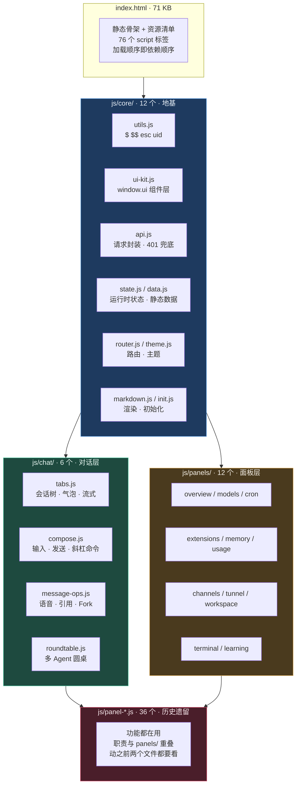
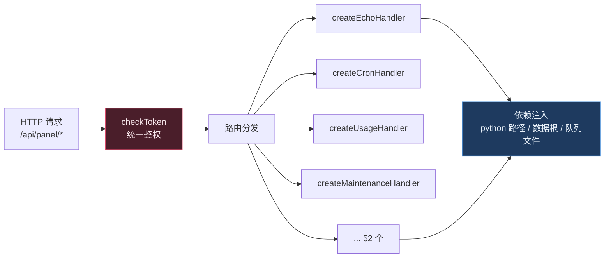

# fnos-hermes-panel

<p align="center">
  <b>把一台 NAS 变成能自己动手改的 AI 控制台</b><br/>
  <sub>Hermes Agent 在 fnOS 上的控制面板 —— 从 658 KB 单文件，拆成 79 个模块、56 条后端责任链，逐字节等价</sub>
</p>

<p align="center">
  <a href="https://vector9584.github.io/fnos-hermes-panel/"><b>项目主页</b></a>
  &nbsp;|&nbsp;
  <a href="https://github.com/vector9584/fnos-hermes-panel/releases/latest"><b>下载安装包</b></a>
  &nbsp;|&nbsp;
  <a href="app/ui/ARCHITECTURE.md"><b>架构规矩</b></a>
  &nbsp;|&nbsp;
  <a href="JOURNEY.md"><b>改造历程</b></a>
</p>

<p align="center">
  <sub>
    <a href="#这是什么">这是什么</a> ·
    <a href="#为什么要拆">为什么要拆</a> ·
    <a href="#拆成了什么样">拆成了什么样</a> ·
    <a href="#怎么证明没改坏">怎么证明没改坏</a> ·
    <a href="#后端责任链">后端责任链</a> ·
    <a href="#架构门禁">架构门禁</a> ·
    <a href="#快速开始">快速开始</a> ·
    <a href="#已知的债">已知的债</a>
  </sub>
</p>

---

## 这是什么

**这台 NAS 上的 AI 助手，控制面板是我自己拆开重写的。**

[Hermes Agent](https://github.com/NousResearch/hermes-agent) 是一个跑在本机的 AI Agent 运行时。它在 fnOS（飞牛 OS）上以 `.fpk` 应用形式安装，网页控制面板负责对话、会话树、模型切换、技能/MCP 管理、定时任务、记忆、用量、终端、通讯渠道、隧道……

这套面板最初是**一个 658 KB 的 `index.html`**：134 KB 内联 `<style>`，470 KB 内联 `<script>`，557 个函数全挤在同一个作用域里。改一行 CSS 要在一万三千行里找位置，加一个面板要在同一个文件里插入几百行，谁后加载谁赢。

这个仓库是把它**拆开之后的样子**，以及拆开过程中长出来的那套工具：架构检查器、部署账本、生产对账、E2E 探针。

拆的过程有一个硬约束：**面板跑在用户的 NAS 上，不能有行为变化。** 所以整个重构的验收标准不是"看起来一样"，而是——

- 全局函数 **638 个**、全局对象 **314 个**，拆前拆后集合**零差异**
- 1440×1000 与 390×844 两种视口截图，禁动画后**逐像素 0 差异**
- 生产目录与源码目录 **SHA-256 逐文件对账**

这不是一个"重写前端"的故事，是一个"如何在别人正在用的生产系统上做大规模结构手术"的故事。

---

## 为什么要拆

原始状态的问题不是"代码丑"，是**三个具体的、每天都会咬人的事**：

| 问题 | 当时的实际表现 |
|---|---|
| **单文件即单点** | 任何一个字符打错（哪怕是个未闭合的字符串），整个面板白屏。没有局部失败这回事 |
| **谁后加载谁赢** | 同名函数在 3 个地方定义，改对了 2 处，第 3 处静默覆盖，改了等于没改 |
| **部署是 `cp`** | 把文件拷过去就算发布。拷了一半、拷错目录、源和目标不同步，全靠人眼发现 |

第二条最贵。举一个真实例子：`toast` 这个提示函数有新旧两版，新版在 `ui-kit.js`，老版在 `utils.js`。老版在原文件里位置更靠后，所以**老版一直赢**——组件层建了但没生效，视觉退回硬编码样式，而且没人看得出异常。

这类问题的共同点是：**代码能跑，现象正确，改动静默失效。** 靠 review 和测试都抓不住，因为没有任何一处报错。

所以拆的目标从一开始就不是"文件变短"，是**让"改哪一处生效"这件事变成可以查的**：

```
拆之前：改一处 → 有没有生效？不知道 → 打开浏览器试 → 试了看不出 → 算了
拆之后：改一处 → 它在哪一层？谁依赖它？arch_lint 报不报？ → 有答案
```

---

## 拆成了什么样

`index.html` 从 **658 KB → 71 KB**（-89%）。剩下的 71 KB 里没有一行业务逻辑，只有静态骨架、资源清单和 76 个 `<script>` 标签。



### 目录

```
app/
├── ui/
│   ├── index.html          71 KB · 只有骨架，无业务逻辑
│   ├── css/                15 个 · 5,093 行
│   │   ├── base.css        主样式表（原 134 KB 内联 style）
│   │   ├── ui-kit.css      组件层样式
│   │   └── panel-*.css     各面板自己的
│   └── js/                 79 个 · 21,001 行
│       ├── core/           12 个 · 基础设施，不依赖任何业务
│       ├── chat/            6 个 · 对话
│       ├── panels/         12 个 · 面板页
│       ├── archive/        10 个 · 档案功能
│       └── panel-*.js      36 个 · 历史遗留
└── server/
    └── panel-*.js          56 个 · 3,576 行 · 后端责任链
```

### 加新东西该放哪

| 你要做的事 | 放哪 | 怎么验 |
|---|---|---|
| 改配色 / 字体 / 主题变量 | `css/base.css` 顶部变量区 | 切主题看 |
| 改弹窗外观 | `css/ui-kit.css` + `js/core/ui-kit.js` | `ui.modal()` 预览 |
| 改消息气泡 | `js/chat/tabs.js` 的 `msgHTML` | 发一条消息 |
| 加一个面板 | `js/panels/<名字>.js` + `css/panel-<名字>.css` | 加 script 标签 + `?v=` |
| 加一个后端接口 | `app/server/panel-<名字>.js` 一个 handler | 生产对账 |
| 确认没破坏规矩 | — | `arch_lint.py` |

---

## 怎么证明没改坏

这是整个项目最花功夫的部分，也是唯一值得写进 README 的部分。**"我看过了，没问题"不算证明。**

### 第一层：符号级等价

拆文件会改变函数的**物理位置**，但不该改变**存在性**。所以验证方法是打开拆前和拆后两版页面，对比 `Object.keys(window)`：

```
拆前：638 个函数 + 314 个对象
拆后：638 个函数 + 314 个对象
差异：0
```

差一个就说明搬迁过程中漏了、重了、或者被后面的覆盖了。这一步能在**不点任何按钮**的情况下抓出 90% 的搬迁错误。

### 第二层：样式级等价

CSS 拆分会踩一个很隐蔽的坑：**层叠顺序变了，权重没变，但赢家变了。**

所以量样式不能只比文件内容，要量**最终生效的计算样式**。`dev/ui_probe.py --eval` 能在真实页面上对任意元素取值（`getComputedStyle`），新旧两版逐属性比对。

### 第三层：像素级等价

最后是截图。但截图有个**假绿陷阱**：如果 `<base href>` 写错导致所有 CSS/JS 都 404，页面会退化成两个"相同"的空壳，截图一模一样，测试全绿，实际两个都坏了。

所以截图验证前必须确认：

1. 资源实际加载成功（不是 404）
2. 全局符号数量对得上
3. **禁用动画**再截（否则等于在比随机数）

满足这三条之后，1440×1000 与 390×844 两档视口，差异像素数 = **0**。

### 那 `?v=` 呢

这份面板没有打包器、没有模块系统，靠 `<script>` 顺序加载。所以改完 `js` / `css` 必须同步改 `<script src="...?v=xxxxxxxx">` 里的缓存后缀（用文件 md5 前 8 位）。

**漏改一个，浏览器就继续用旧版，你以为改了。** 这一条写进了检查器。

---

## 后端责任链

前端 71 KB 是冰山上面。下面是 `app/server/` 的 **56 个 `panel-*.js`**，共 3,576 行，平均每个 **64 行**。

拆法很简单，一句话：**一个接口域一个文件，每个文件导出一个 handler 工厂。**



每个 handler 都是纯函数式的依赖注入，不直接 `import` 全局状态：

```js
const handleEcho = createEchoHandler({
  python:      `${VENV_BIN}/python3`,
  serverRoot:  join(APP_DIR, 'server'),
  queueFile:   join(HOME_DIR, 'tasks.json'),
  backupRoot:  join(VAR_DIR, 'panel-state/echo-backups'),
  checkToken,
});
```

好处很直接：**改一个面板的后端，只需要打开一个 64 行的文件**，不用在一个 9,473 行的 `monitor.js` 里找。而且 handler 可以单独测——它的所有外部依赖都是参数。

顺带一提：`monitor.js` 本体仍然是 9,473 行的大文件。这是**故意留的**——它负责进程管理、自动更新、渠道接入这些**跨域编排**，不属于任何一个面板。把所有东西都拆开是另一种形式的过度工程。

---

## 架构门禁

规矩写在文档里没人看。所以这套项目把规矩变成了**可执行检查**。

`dev/arch_lint.py` 扫描前端所有 JS，输出：

```
扫描 79 个 JS，违规 110 条（存量 103，新增 7）
```

规则按层分开，不重叠：

| 层 | 工具 | 查什么 |
|---|---|---|
| **命名与契约** | `arch_lint.py` | 新造的卡片/按钮类名、自建 toast、绕过 `ui.*` 手拼模态框 |
| **死代码** | `arch_symbols.py` | 定义了但没有任何 `<script>` 引用的文件、从来不被调用的函数 |
| **等价性** | `arch_doc_gen.py` | 从代码生成架构文档里的数字，防止文档写死过时 |

关键设计是**存量 / 新增分离**：

- 存量 103 条 = 历史债，登记在 `arch_lint_baseline.json`，不阻断提交
- 新增 7 条 = 这次引入的，**必须修或写明理由**

这样门禁能上线，而不是一上来就报 103 条把人劝退。老债慢慢还，新债不许欠。

举个它抓到的真实问题：`archive/archive-core.js:580` 自己写了一个 `toast`。看起来能弹提示，实际问题是没有走统一组件层——将来改提示样式，这里不会跟着变。**代码能跑，问题不出现在屏幕上。**

---

## 快速开始

### 前提

- fnOS（飞牛 OS），或其他能跑 Node.js + Python 的 Linux
- 已安装 [Hermes Agent](https://github.com/NousResearch/hermes-agent)
- Node.js ≥ 18，Python ≥ 3.10

### 安装

从 [Releases](https://github.com/vector9584/fnos-hermes-panel/releases/latest) 下载 `.fpk`，在 fnOS 应用中心手动安装。

或者从源码部署：

```bash
git clone https://github.com/vector9584/fnos-hermes-panel.git
cd fnos-hermes-panel

# 部署到生产目录（有账本，不是裸 cp）
bash dev/deploy-workspace.sh

# 重启应用（唯一合法路径，别用 pkill）
fnos-cli --profile nas app restart hermes-agent --yes

# 生产对账：源码目录 vs 运行目录，逐文件 SHA-256
bash dev/verify-prod.sh
```

### 只预览前端，不碰生产

```bash
bash dev/hermes-dev.sh 8917
# → http://<nas-ip>:8917/app/hermes-agent/
```

这个模式只读 `app/ui`，起一个静态服务，不启动后端、不碰数据库、不影响正在跑的实例。改 CSS 的时候用它，改后端才需要真部署。

---

## 已知的债

诚实列出来，比藏起来好。

| 债 | 规模 | 影响 |
|---|---|---|
| **`js/panel-*.js` 未并入三层** | 36 个文件 | 与 `js/panels/` 职责重叠，同一个面板要改两处 |
| **原生 `confirm()` / `alert()`** | 38 + 2 处 | 样式不可控，且 `confirm` 是同步阻塞，换 `await ui.confirm()` 要改函数签名 |
| **`ui.*` 组件层未全覆盖** | 已调用 60 次，历史代码仍在手拼 | 新代码用 `ui.*`，老代码没换 |
| **`monitor.js` 仍是 9,473 行** | 1 个文件 | 跨域编排故意不拆，但单测困难 |
| **前端没有模块系统** | — | 靠 `script` 顺序，加载顺序是隐式契约，改顺序可能静默出错 |

这些不是"待办清单"，是**已经量过的现状**。每一条都有对应检查器或文档章节。

---

## 文档

| 文档 | 内容 |
|---|---|
| [`app/ui/ARCHITECTURE.md`](app/ui/ARCHITECTURE.md) | 前端架构规矩 —— **唯一真源**。改代码前先对号入座 |
| [`JOURNEY.md`](JOURNEY.md) | 改造历程：每次拆的依据、踩的坑、放弃的方案 |
| [`UPDATE-LOG.md`](UPDATE-LOG.md) | 按时间排的改动流水 |
| [`CHANGELOG.md`](CHANGELOG.md) | 上游 Hermes Agent 的变更 |

`app/ui/ARCHITECTURE.md` 不是介绍文档，是**判据**：它回答"要改东西，该动哪个文件"，也回答"这样写算不算破坏规矩"。

---

## 致谢与许可

- **[Hermes Agent](https://github.com/NousResearch/hermes-agent)** — Nous Research，本项目的运行时本体
- **[veenyi/fnos-hermes-agent](https://github.com/veenyi/fnos-hermes-agent)** — fnOS `.fpk` 打包层，本仓库建立在其基础上
- **fnOS / 飞牛 OS** — 应用运行环境与桌面集成

本项目以 **GPL-3.0** 发布，与上游一致。

---

<p align="center">
  <sub>
  这份 README 里的每个数字都是跑出来的，不是估的。<br/>
  如果你在 NAS 上也有了同样的"改一处不知道哪处生效"的问题 —— 大概就是该拆的时候了。
  </sub>
</p>
